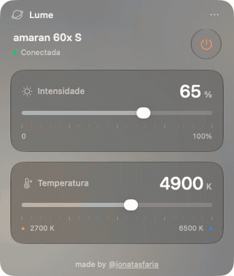
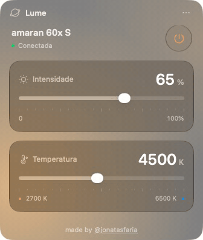
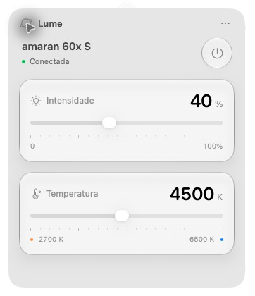
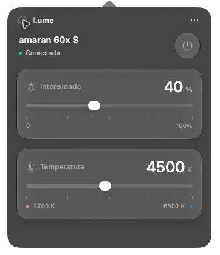

# Lume

A native macOS glass control panel for your amaran light. Pair directly over Bluetooth, then control power, brightness and white temperature from the sun icon. No phone, Sidus Link, amaran Desktop or background web server required.

**Verified with the amaran 60x S. Other models are not verified in Lume yet.**

[Português](README.md) · [Support with R$5 via Pix](docs/APOIAR.md) · [Download](https://github.com/joefaria/lume-amaran/releases) · [Compatibility](COMPATIBILITY.md) · [Contributing](CONTRIBUTING.md)

<p align="center">
  <picture>
    <source media="(prefers-reduced-motion: reduce)" srcset="docs/preview-dark.png">
    
  </picture>
  <picture>
    <source media="(prefers-reduced-motion: reduce)" srcset="docs/preview-light.png">
    
  </picture>
</p>

*Native interface demonstrations with illustrative values. Reduced-motion preference displays static alternatives.*

<details>
<summary>Static light and dark screenshots</summary>

 

</details>

*Native panel screenshots. See [COMPATIBILITY.md](COMPATIBILITY.md) for hardware validation and [the design notes](docs/DESIGN.md) for materials and accessibility.*

## Download and run

1. Download `Lume-macOS.zip` from [Releases](https://github.com/joefaria/lume-amaran/releases).
2. Unzip and move `Lume.app` to your Applications folder.
3. Open the app and click its sun icon in the menu bar. Allow Bluetooth access when macOS asks.

The current executable targets **Apple Silicon (M1 or later), macOS 13+**. It has been tested on the development Mac; other supported macOS versions and Intel builds have not been validated. The interface is in Portuguese. There are no Node or Python runtime dependencies.

The downloadable app is locally ad-hoc signed and **not Apple-notarized**. macOS may block a downloaded build; local signature validation is not Gatekeeper approval. You can also build from the source below.

## Pair your light

1. Turn on your amaran and keep it near the Mac.
2. If it still belongs to an old Bluetooth network, use **BT Reset** on the light and wait for **Success**. This removes its previous pairing; Lume does not perform the reset.
3. Click **Buscar minha amaran** and select your own light marked **Pronta para parear**. It may advertise as `Mesh Device`.
4. Wait for pairing and configuration. The controls become available after the light reports its authenticated state.

Pairing does not change brightness or temperature. Opening Lume reads the light's state and does not apply old settings. Power controls the emitter while the fixture remains electrically powered so Bluetooth stays available. Reconnection after a dropped connection is manual in this version.

An optional advanced import accepts supported lighting JSON, an existing unencrypted iPhone backup, or an existing amaran Desktop database. This is not needed for direct pairing. See [the Portuguese guide](docs/GUIA.pt-BR.md#importação-opcional-de-uma-configuração-existente) for its exact boundaries. Do not weaken backup encryption to use the importer.

## What works today

- Compact glass instrument panel with Phosphor icons and a monochrome menu bar symbol.
- Native Liquid Glass on macOS 26+, translucent material fallback on older systems.
- Ambient temperature glow behind the controls, visible only while the connected light reports its emitter on. Warm amber through neutral light to cool blue, based on confirmed temperature.
- Light and dark appearance; follows macOS by default, with optional app overrides in settings.
- One selected light, saved locally.
- Direct PB-GATT pairing and authenticated Mesh Proxy connection.
- Emitter power and 0–100% brightness.
- White temperature **2700–6500 K**. Three fixed presets are available under the options menu.
- Sliders stay active while commands are confirmed in the background, without an applying spinner.
- One command in flight; rapid changes retain the latest unsent value per control, including combined brightness/CCT edits.
- Commands confirmed by the light, with explicit timeout handling.
- Optional launch at login, disabled by default.
- Persistent transmission counters reserved before sending.

The 60x S has passed real pairing, reconnection, power, brightness and temperature checks. There are 89 automated checks for cryptography, authentication, provisioning, import, persistence and command sequencing.

## Can it control any amaran?

Not yet. Other public controllers use the same amaran/Telink protocol for several models, which makes adaptation plausible. Lume still contains 60x S temperature limits, generic-name fallbacks and specific provisioning/status assumptions. Bluetooth or Sidus Link support alone does not prove compatibility.

Color/HSI, green/magenta tint, effects, battery reporting, multiple fixtures and groups are not implemented. Fixed-white fixtures need a profile that hides temperature controls. See [COMPATIBILITY.md](COMPATIBILITY.md) for evidence, source links and the changes needed to add a model.

## Build from source

Requirements: an Apple Silicon Mac, recent Apple Command Line Tools with Swift and the macOS SDK. Development validation used Swift 6.4. Node is needed only to generate independent test vectors.

```sh
git clone https://github.com/joefaria/lume-amaran.git
cd lume-amaran
zsh test.sh
zsh build.sh
```

The executable is packaged in `dist/Lume-macOS.zip`. Builds use a temporary local directory for signing to avoid iCloud/File Provider attributes. Set `LUME_OUTPUT_DIR` to select another output directory. `build.sh` does not install or start the app, register a login item or access Bluetooth.

There are no external runtime packages. Test vectors use Node's built-in crypto implementation. Automated tests use synthetic or published keys and a simulated P-256 peer, not your light or Keychain.

To render the interface without connecting to hardware:

```sh
/path/to/Lume.app/Contents/MacOS/Lume --render /tmp/lume-preview.png connected
```

Render states include `connected`, `setup`, `offline`, `pending`, `error`, `off`, `warm` and `cool`. Their light settings are illustrative. Development-only `--pair`, `--verify-control`, `--verify-temperature`, `--verify-power` and `--verify-responsive` modes perform real Bluetooth operations; the verification modes briefly change and restore the relevant setting, so they are not part of the automated tests.

The offscreen `--render` helper is a layout preview; macOS compositor glass/vibrancy may not be captured faithfully. Use the native app for final appearance validation.

## Local data

Network, application and device keys are generated during pairing and stored in the macOS Keychain under `dev.jonatas.lume.bluetooth`. Imported keys are stored there too. Sequence counters are stored with private permissions in `~/Library/Application Support/Lume/sequence-<networkID>.json`. Never delete/reset those counters for a live network or publish mesh exports, databases or phone backups.

Lume makes no internet requests during light control. `.build/`, generated packages and local state are excluded from the source repository.

## License and credits

[MIT License](LICENSE), copyright 2026 Jonatas Faria. Third-party notices are retained in [THIRD_PARTY_NOTICES.md](THIRD_PARTY_NOTICES.md) and bundled with the executable.

Protocol references include [wesbos/amaran-BLE-control](https://github.com/wesbos/amaran-BLE-control), [neyako/amaran-hacs](https://github.com/neyako/amaran-hacs), the [Bluetooth SIG provisioning description](https://www.bluetooth.com/blog/provisioning-a-bluetooth-mesh-network-part-2/), and [aarondfrancis/amaran](https://github.com/aarondfrancis/amaran) for observed backup layout and provisioning/configuration reference. No upstream Swift helper or official app binary is bundled. No official application was decompiled as part of this project.

Lume is an independent community project, not affiliated with or endorsed by amaran or Aputure.
