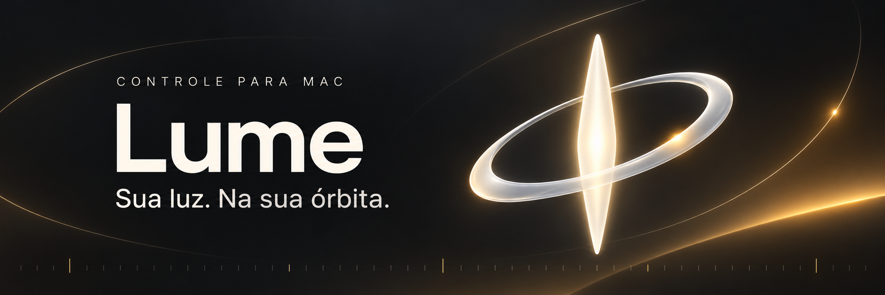
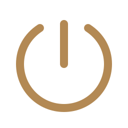
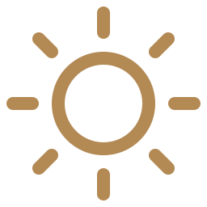
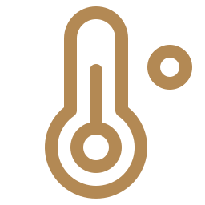
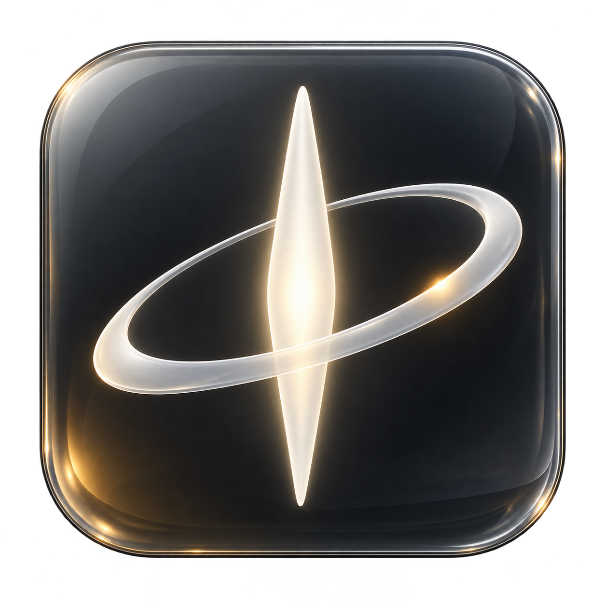

<p align="center">
  
</p>

# Sua amaran, na barra de menus do Mac.

Ligue, ajuste a intensidade e encontre a temperatura certa sem sair do que está fazendo. O **Lume** conecta sua luz diretamente ao Mac por Bluetooth, em um painel nativo com a identidade glass do macOS.

<p>
  <a href="https://github.com/joefaria/lume-amaran/releases/latest/download/Lume-macOS.zip"></a>
  <a href="docs/APOIAR.md"></a>
</p>

**Apple Silicon · macOS 13+ · Código aberto · MIT**

[English](README.en.md) · [Como conectar](#comece-em-poucos-passos) · [Compatibilidade](COMPATIBILITY.md) · [Contribuir com código](CONTRIBUTING.md)

## Um pequeno painel. O controle que você precisa.

<table>
<tr>
<td width="33%" valign="top">

<h3>Ligue e apague</h3>
Controle o emissor sem interromper a conexão Bluetooth.
</td>
<td width="33%" valign="top">

<h3>Encontre a intensidade</h3>
Ajuste de 0 a 100%, com controles que continuam livres durante o envio.
</td>
<td width="33%" valign="top">

<h3>Escolha o clima</h3>
De 2700 a 6500 K, com um brilho de fundo que acompanha a temperatura da luz acesa.
</td>
</tr>
</table>

## Feito para se sentir em casa no Mac.

<p align="center">
  <picture>
    <source media="(prefers-reduced-motion: reduce)" srcset="docs/preview-dark.png">
    
  </picture>
  &nbsp;
  <picture>
    <source media="(prefers-reduced-motion: reduce)" srcset="docs/preview-light.png">
    
  </picture>
</p>

<p align="center"><sub>Da luz quente à fria · Do modo escuro ao claro</sub></p>

Demonstrações do painel nativo com valores ilustrativos. O primeiro GIF mostra a temperatura e o gradiente ambiente; o segundo, a alternância de aparência. Se você prefere reduzir movimento, as imagens acima aparecem estáticas.

<details>
<summary><strong>Ver capturas estáticas em claro e escuro</strong></summary>

<p align="center">
  
  &nbsp;
  
</p>

<p align="center"><sub>Capturas do aplicativo nativo · Aparência clara e escura · Símbolo monocromático na barra de menus</sub></p>

</details>

O painel acompanha a aparência do sistema, com opção de escolher Claro ou Escuro. Usa **Liquid Glass no macOS 26+**, material translúcido nas versões anteriores e ícones Phosphor. Respeita os ajustes de acessibilidade de contraste, transparência e movimento.

Sem celular ou Sidus Link durante o uso. Sem servidor em segundo plano. As credenciais ficam no **Chaves do macOS** e o controle acontece localmente por Bluetooth.

## Comece em poucos passos

| | O que fazer |
| :--- | :--- |
| **01 · Baixe** | Baixe o [Lume para Mac](https://github.com/joefaria/lume-amaran/releases/latest/download/Lume-macOS.zip), descompacte e mova `Lume.app` para Aplicativos. |
| **02 · Abra** | Abra o Lume, autorize o Bluetooth quando o macOS pedir e clique no símbolo orbital na barra de menus. |
| **03 · Conecte** | Ligue a amaran perto do Mac. Clique em **Buscar minha amaran** e selecione sua luz marcada **Pronta para parear**. Ela pode aparecer como `Mesh Device`. |
| **04 · Ajuste** | Aguarde o pareamento e a leitura do estado da luz. Depois, controle intensidade, temperatura e liga/desliga pelo painel. |

Se a luz ainda estiver vinculada a outra rede Bluetooth, faça **BT Reset** na própria luz e aguarde **Success** antes de buscar. Isso remove o pareamento anterior; o Lume não executa esse reset. Parear ou abrir o app preserva os ajustes de iluminação atuais.

<details>
<summary><strong>Requisitos e informações sobre a instalação</strong></summary>

- **Mac com Apple Silicon (M1 ou posterior)** e macOS 13 ou posterior. Não há versão Intel validada; outras versões do macOS além do Mac de desenvolvimento ainda precisam de validação.
- O app é assinado localmente, **sem notarização Apple**. O macOS pode bloquear uma versão baixada. A verificação da assinatura local não equivale à aprovação de Gatekeeper em outro Mac.
- A interface está em português. O executável não depende de Node, Python ou outros pacotes durante o uso.
- A abertura ao iniciar sessão é opcional e vem desligada. A reconexão após uma queda é manual nesta versão.
- Já tem uma configuração de rede? Veja a [importação opcional](docs/GUIA.pt-BR.md#importação-opcional-de-uma-configuração-existente).

</details>

## Sua luz é compatível?

| Validado com uma luz real | Ainda depende de adaptação e testes |
| :--- | :--- |
| **amaran 60x S** — pareamento, reconexão, liga/desliga, intensidade e temperatura. | Outros modelos amaran, luzes de branco fixo, RGB/HSI, efeitos, grupos e múltiplas luzes. |

A base pode evoluir com os pedidos da comunidade. Ter Bluetooth ou funcionar no Sidus Link, por si só, não confirma compatibilidade com o Lume.

[Ver os limites atuais](COMPATIBILITY.md) · [Pedir suporte ao seu modelo](https://github.com/joefaria/lume-amaran/issues/new)

## Apoie o Lume

O Lume é gratuito e de código aberto. Se ele ajudou no seu dia, você pode contribuir com **R$ 5 via Pix** para apoiar a continuidade do projeto. É totalmente opcional.

<a href="docs/APOIAR.md"></a>

O botão abre o **QR Code e o Pix copia e cola**. Você conclui a contribuição no aplicativo do seu banco.

Também ajuda muito [reportar um problema](https://github.com/joefaria/lume-amaran/issues), testar sua luz ou [contribuir com código](CONTRIBUTING.md).

## Para quem quer construir junto

```sh
git clone https://github.com/joefaria/lume-amaran.git
cd lume-amaran
zsh test.sh
zsh build.sh
```

O pacote fica em `dist/Lume-macOS.zip`. São **89 verificações automatizadas** de protocolo, autenticação, pareamento, importação, persistência e sequência de comandos. Os testes usam dados sintéticos ou publicados e não acessam sua luz nem o Chaves.

[Guia técnico e requisitos de desenvolvimento](docs/GUIA.pt-BR.md) · [Como contribuir](CONTRIBUTING.md) · [Notas de design](docs/DESIGN.md)

---

<p align="center">
  <br>
  made by <a href="https://www.instagram.com/jonatasfaria/">@jonatasfaria</a><br>
  <sub>Projeto independente, sem vínculo oficial com amaran ou Aputure.<br>
  <a href="LICENSE">Licença MIT</a> · <a href="THIRD_PARTY_NOTICES.md">Créditos e referências</a></sub>
</p>
